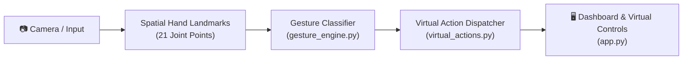

# 🖐️ AI Virtual Hand Gesture Controller

An intelligent Computer Vision application that uses hand landmark recognition to control desktop actions—such as navigating slide presentations, adjusting volume, and toggling media playback—using touchless physical gestures.

Developed by **[Samyog](https://github.com/hola-mundo999)** · *Computer Vision & Applied AI*.

---

## 🌟 Key Features

1. **Spatial 21-Landmark Hand Tracking:**
   - Tracks 21 anatomical 3D joints per hand using the MediaPipe / Euclidean distance convention.
2. **Gesture Recognition Engine:**
   - **🤏 Pinch:** Real-time continuous volume adjustment and mouse drag.
   - **👍 Thumbs Up:** Advance slide presentation.
   - **✌️ Victory / V-Sign:** Play / Pause video or audio.
   - **✊ Closed Fist:** Instant audio mute.
   - **🖐️ Open Palm:** Cursor tracking mode.
3. **Interactive Control Dashboard:**
   - Modern dark-mode web interface built with **Streamlit**.
   - Includes real-time event audit logs, virtual slide presentation screen, volume gauges, and gesture simulator.
4. **Edge CPU Optimized:**
   - Lightweight algorithm designed for smooth 30+ FPS operation without requiring expensive GPUs.

---

## 🏗️ System Architecture



---

## 🛠️ Tech Stack

- **Language:** Python 3.10+
- **Computer Vision:** OpenCV, NumPy
- **Interface / Dashboard:** [Streamlit](https://streamlit.io/)
- **Version Control:** Git & GitHub

---

## 🚀 Getting Started

### 1. Clone the repository
```bash
git clone https://github.com/hola-mundo999/ai-gesture-controller.git
cd ai-gesture-controller
```

### 2. Set up virtual environment
```bash
python -m venv venv
venv\Scripts\activate   # Windows
```

### 3. Install dependencies
```bash
pip install -r requirements.txt
```

### 4. Run the application
```bash
streamlit run app.py
```

Open `http://localhost:8501` to view the gesture controller dashboard.

---

## 📜 License
MIT License — Free to use, adapt, and build upon.
