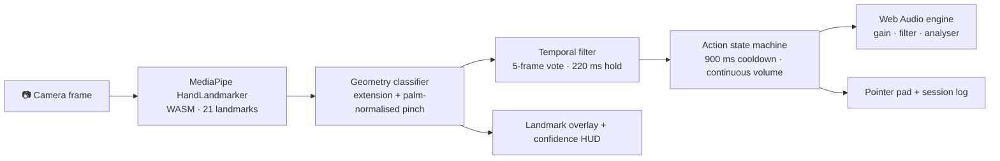

# 🖐️ Gesture Controller

Media and pointer control without touching anything. A camera frame is reduced to
21 hand landmarks, classified into five postures, and routed to real controls:
playback, volume, mute, track selection and an on-screen pointer. Inference runs
inside the tab, with no upload, no account and no backend.

**[Open `index.html`](index.html)** or run the local server below.

---

## What it does

| Gesture | Control | Behaviour |
| --- | --- | --- |
| 🖐️ Open palm | Pointer | Continuous; the palm centre steers a pointer across the pad. |
| 🤏 Pinch | Volume | Continuous; thumb to index gap maps to 0 to 100%, normalised by palm width. |
| ✌️ Peace | Play / pause | Discrete; toggles the audio engine and logs the state. |
| 👍 Thumbs up | Next track | Discrete; advances through the playlist. |
| ✊ Closed fist | Mute / unmute | Discrete; toggles audio and clears mute on the next volume change. |

Every action is also available from the transport bar and the keyboard, so the
controller stays usable without a camera.

### What is actually being controlled

The media engine is a small Web Audio pad: three oscillators through a
low-pass filter with a slow cutoff LFO, one voice set per track. Volume and mute
change a real gain stage, play/pause gates it, next track swaps the chord, and
the waveform is drawn from an `AnalyserNode`, so what you see is the signal that
is actually playing. There is no fake progress bar and no mocked state.

### Under the hood

- **Real tracking, not a mock.** MediaPipe's `HandLandmarker` runs in WebAssembly
  in the tab; frames are never proxied to a server.
- **Palm-normalised geometry.** Pinch distance is divided by palm width, so the
  same thresholds work near the lens and across a room.
- **Temporal voting.** The last five frames vote; a label must survive a 220 ms
  hold before it fires. Discrete commands share a 900 ms cooldown so one gesture
  never lands twice. Pinch streams continuously and smooths toward its target.
- **Live instrumentation.** Confidence, inference rate, the landmark overlay and
  a timestamped session log make the classifier's behaviour visible.
- **Simulator fallback.** No camera, no permission, or a blocked CDN? The same
  state machine runs from a synthetic hand, the palette steers the pointer with
  the mouse, and the pinch slider drives volume.
- **Accessible controls.** Every gesture has a button and a shortcut
  (`Space` playback, `M` mute, `←` `→` tracks, `V` vision), with focus states
  and reduced-motion support.

---

## Architecture



```
index.html · styles.css · app.js   the controller (no build step, no framework)
app.py                             optional Streamlit host (inlines the app)
gesture_engine.py                  Python reference classifier + synthetic hands
virtual_actions.py                 Python reference action dispatcher
tests/                             pytest suite for the reference implementation
```

The browser classifier mirrors `gesture_engine.py` rule for rule; the Python
modules stay as the documented reference and are what the test suite exercises.

---

## Run it

### Static (recommended, full camera access)

```bash
python -m http.server 8000
# open http://localhost:8000
```

Camera access requires a secure context: `localhost` or HTTPS. Opening
`index.html` directly from disk (`file://`) will not expose a camera in most
browsers. The app detects that and switches to the simulator.

### Streamlit host

```bash
python -m venv venv
venv\Scripts\activate          # Windows
pip install -r requirements.txt
streamlit run app.py
```

The Streamlit entry inlines the same app into a component iframe. If your browser
blocks camera permission inside an embedded frame, open the static version above,
the app says so and keeps the simulator available.

### Deploy

The repository root is a static site: import it into Vercel (framework preset
“Other”) and it serves `index.html` as-is. The model and WASM runtime load from
MediaPipe's public CDN; no environment variables are required.

---

## Tests

```bash
pip install -r requirements.txt
pytest
```

The suite covers all five classifications, malformed landmark input, distance
math, and the dispatcher: track advance, wrap-around at the end of the playlist,
volume bounds, media toggle, mute, cooldown and history cap.

---

## Notes on accuracy

- One hand at a time, tracked at the camera's native frame rate.
- Bright, front-on lighting and a hand that fills a third of the frame work best.
- A pinch close to a fist is the ambiguous case; requiring the index fingertip to
  sit above the knuckle keeps the two apart.
- Thresholds live at the top of the classifier in `app.js` and mirror the
  constants in `gesture_engine.py`.

---

MIT License, free to use, adapt and build upon.

Built by **[Samyog Sapkota](https://github.com/hola-mundo999)**.
